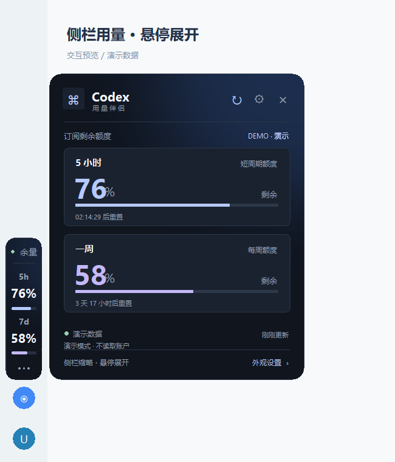
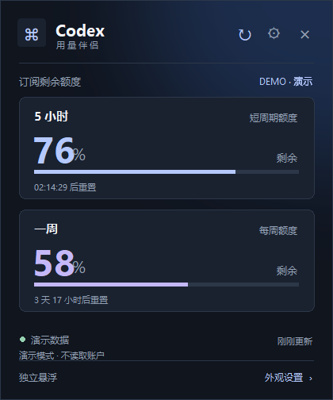
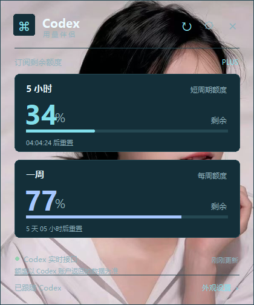

# Codex 用量伴侣

Windows 桌面小工具，为 Codex 桌面客户端提供一个可跟随窗口的额度面板。

- 显示 **5 小时 / 一周剩余百分比**与重置倒计时，每 60 秒刷新，支持手动刷新。
- 默认以窄缩略条显示在客户端左侧、账户头像上方；鼠标悬停后在右侧展开完整额度面板，移开后自动收起。
- 三套配色：月夜、深海、松林；支持本地 PNG / JPG / WebP / BMP 背景、自定义背景遮罩和窗口透明度。
- 跟随 Codex 窗口移动及最小化，跟随时可自由拖动并记住相对位置；支持手动切换独立置顶与精简模式。
- 支持当前用户的 Windows 登录计划任务；后台独立运行、异常退避重启、单实例和托盘恢复，不需要再进入 Codex 项目点击启动。
- 只读取额度，不发起对话、不消耗推理额度，也不修改 Codex 安装文件。

这是一个独立的 Windows 悬浮窗口，覆盖在 Codex 窗口上方；它不是对 Codex 客户端原生界面的修改。

## 启动

需要 **Windows 10 / 11、Python 3.11 或更新版本**，以及已登录 ChatGPT 账户的 Codex 桌面客户端或 Codex CLI。

在项目目录打开 PowerShell：

```powershell
python -m pip install -r requirements.txt
python run.py
```

也可以直接双击 **`启动面板.vbs`**，隐藏终端启动。右键 `Start-Widget.ps1` →「使用 PowerShell 运行」也可以。启动器仅在本次进程中使用执行策略参数，不修改系统执行策略。

不使用图片时无需安装 Pillow，文字和进度条仍可使用。若 `python` 命令不可用，使用 Python 的完整路径，或改用 `py`。

```powershell
py run.py
```

## 持久自动启动

在「外观设置」中勾选 **Windows 登录后自动运行（当前用户）**，或在项目目录运行一次：

```powershell
python run.py --enable-startup
```

开启后立即运行；以后每次登录 Windows，系统延迟约 10 秒启动后台守护进程，由它运行现有的 `run.py` 界面。守护进程阻塞等待自己的界面子进程，异常退出时按 1、5、15、30、60 秒退避恢复，不轮询 Codex 账号。

默认侧栏模式等待 Codex 窗口出现，客户端关闭时隐藏并保留后台进程，重新打开时自动恢复缩略条。切换到「独立悬浮」后，可在关闭 Codex 时继续显示窗口；此时额度读取仍需要可用的 Codex CLI 登录状态。窗口可先显示，认证暂不可用会显示原有错误/历史数据状态，并按原刷新周期重试。

使用 Windows 原生任务计划程序，名称为 `CodexQuotaWidget-<用户与项目路径摘要>`；仅当前用户、交互登录、不保存密码、不请求提权。项目目录、Python 路径需保持有效；移动项目前请先关闭自动启动，移动后重新开启。首次启用会清理与本项目命令完全匹配的旧版 `HKCU Run` 项，其他启动项不受影响。

关闭、检查和恢复：

```powershell
python run.py --disable-startup
python run.py --startup-status
python run.py --restore
python run.py --stop
```

启用自动启动后，× / Esc 隐藏窗口并保留进程；单击系统托盘图标、右键「恢复窗口」或执行 `--restore` 可恢复。再次运行普通启动入口也会唤回已有窗口。右键「退出程序」或 `--stop` 是明确退出，当次会话不会自动复活；下次 Windows 登录仍会启动，也可随时 `--restore`。关闭自动启动只删除本项目计划任务，保留当前窗口，× / Esc 恢复为退出。

此方案不依赖 Codex 项目登录事件或运行按钮。三种启动情况、账户依赖、诊断及手工验收见 [自动启动说明](docs/AUTOSTART.md)。

## 操作

默认侧栏模式下，缩略条只显示 `5h` / `7d` 两项剩余百分比和状态点。悬停约 120 毫秒后展开现有完整面板；从缩略条移入面板时留有约 280 毫秒缓冲，打开外观设置或数据连接窗口期间保持展开。点击缩略条也可立即展开，右键提供快捷菜单。客户端移动或最小化时，缩略条和详情面板会一起跟随或隐藏。

在「外观设置」取消 **侧栏缩略显示（悬停展开）**，可恢复普通浮窗；侧栏模式默认开启，也会应用于原有配置。缩略条自动按客户端 DPI 缩放，沿用现有主题、背景和透明度。定位依据客户端左侧导航栏及底部头像区的布局；客户端未来若改变导航栏结构，可能需要重新调整定位。

| 操作 | 效果 |
| --- | --- |
| 悬停 / 点击左侧缩略条 | 在右侧展开完整额度面板 |
| 右上角 ↻ | 立即刷新真实账户额度 |
| 齿轮 / 右下角「外观设置」 | 主题、背景图片、遮罩、透明度、精简模式、刷新频率 |
| 左下角「跟随 Codex / 独立悬浮」 | 切换窗口模式 |
| 完整模式底部的数据来源区域 | 查看采集时间、重置时间，或手动选择 Codex CLI |
| 普通浮窗模式下拖动顶部 | 自由摆放，保持当前模式；跟随模式下保存相对 Codex 的位置 |
| 右键面板 | 快捷菜单 |
| × / Esc | 自动启动开启时隐藏到后台；关闭自动启动时退出 |
| 单击系统托盘图标 / 再次运行启动入口 | 恢复窗口，保持单实例 |
| 右键「退出程序」 | 明确退出本次运行，保留下次登录启动配置 |

跟随模式识别 Codex 桌面程序，包括安装包名称为 `OpenAI.Codex`、进程显示为 `ChatGPT.exe` 的版本。默认侧栏及自动启动的跟随模式在找不到 Codex 时隐藏等待；独立悬浮可继续显示。Codex 未打开、最小化或隐藏时，托盘或 `--restore` 会临时显示独立面板，客户端可见后恢复侧栏。精简模式下点击底部状态区打开设置。

配置保存在项目下的 `.local/settings.json`。演示模式使用单独的 `.local/demo-settings.json`，不会覆盖正常设置。删除相应配置文件即可恢复默认设置。背景图片保存的是本地文件路径，移动图片后需要重新选择。

## 数据来源和显示边界

优先调用官方文档提供的 Codex App Server `account/rateLimits/read` 方法，复用 Codex 自己管理的登录状态。流程仅为 `initialize` → `initialized` → `account/rateLimits/read`；不会调用 `thread/start`、`turn/start` 或任何额度重置方法。

参考：[OpenAI 官方 App Server 文档](https://learn.chatgpt.com/docs/app-server)。

如果实时接口不可用，会尝试从本机 `$CODEX_HOME/sessions`（默认 `~/.codex/sessions`）近期会话日志的额度事件中读取历史快照，并在面板标出来源和更新时间。程序只提取额度字段，不展示、保存或上传对话内容，不直接读取 `auth.json`，没有自建服务器或分析上报。Codex App Server 在查询实时额度时会连接 OpenAI 服务。

- 剩余百分比 = `100 - usedPercent`，不是剩余条数或 Token 数。
- 按接口实际返回的 300 分钟和 10080 分钟窗口归类，不把其他窗口当成 5 小时或一周。
- 某些账户没有相应周期限制，或服务没有返回该窗口，面板会显示「未提供」。不将缺失数据解释为 100%。
- 历史数据到达重置时间后显示「等待刷新 / 上次剩余」，不会自行把百分比重置为 100%。
- 账户规则可能变化，以实际服务返回值为准。[官方用量说明](https://learn.chatgpt.com/docs/pricing)
- CLI 与桌面客户端应使用相同账户及 `CODEX_HOME`。若手动切换过 CLI 账户，请核对两者的登录状态；历史日志可能来自切换前的账户。

## 诊断和开发

```powershell
# 只读取并输出真实额度 JSON，不启动界面
python run.py --check

# 演示界面：不读取账户、不调用 Codex
python run.py --demo

# 生成演示截图并退出（需要 Pillow）
python run.py --demo --screenshot docs/preview.png

# 单元测试
python -m unittest discover -s tests -v
```

如果实时读取失败，先检查 Codex 是否已登录、`codex --version` 是否正常。使用 API Key 的账户不一定提供订阅周期额度。CLI 不在 PATH 时，读取器会尝试查找桌面版附带的 CLI；也可以右键面板 →「数据与连接」→「选择 codex.exe」手动指定路径，或在 Python 中使用 `UsageService(codex_command=...)`。运行诊断保存在 `.local/runtime.log`，守护进程日志为 `.local/settings.supervisor.runtime.log`。日志按 256 KiB 滚动、保留两份备份，不记录原始异常文本、账户内容或令牌。

## 界面预览

侧栏缩略显示与悬停展开效果（模拟客户端布局、演示数据）：



以下是普通浮窗模式的两种外观，右图使用了自定义背景。实际用量及倒计时会随账户状态更新。

| 默认主题（演示数据） | 自定义背景示例 |
| --- | --- |
|  |  |

普通浮窗跟随模式下，拖动面板只调整相对 Codex 的位置，松开后继续跟随，并保存位置供下次启动使用。手动重新开启跟随时保持当前位置；点击模式开关才会切换为独立悬浮。

## 文件

```text
run.py                     启动、演示、诊断入口
quota_widget/app.py        面板和外观设置
quota_widget/sidebar.py    头像上方的缩略额度条
quota_widget/hover.py      悬停展开、收起与对话框保持
quota_widget/usage.py      额度读取与解析
quota_widget/windows.py    Windows 窗口跟随
quota_widget/settings.py   设置校验与保存
quota_widget/startup.py    当前用户启动联动、单实例保护
quota_widget/supervisor.py 界面进程异常恢复，阻塞等待、退避重试
quota_widget/tray.py       Windows 原生托盘与窗口恢复
quota_widget/watcher.py    原生窗口事件和低频兜底检测
quota_widget/diagnostics.py 有限大小的脱敏运行日志
Startup-Task.ps1           当前用户计划任务的安装、检查、运行、删除
docs/AUTOSTART.md          自动启动原理、命令与验收方法
tests/                     数据解析、RPC、配置测试
启动面板.vbs                双击启动入口
Start-Widget.ps1           隐藏终端的启动脚本
requirements.txt           可选的图片支持依赖
```
